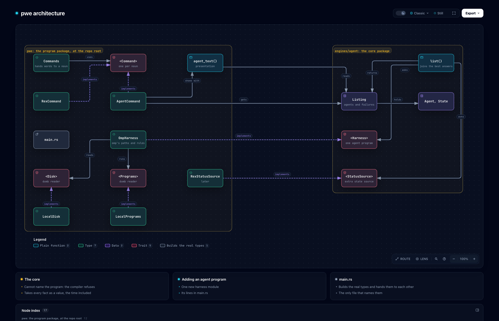

# Architecture

The picture is drawn from `docs/architecture.json`. `<Name>` is a trait. `name()` is a plain function.

## Packages

| Package | Path | May use |
| --- | --- | --- |
| program | repo root | the core |
| agent core | `engines/agent` | the standard library |

A second engine gets its own package under `engines/`.

## The core

- `Agent` is one running session of one agent program: which program, its folder, its `State`, and where known its session, title and process.
- `<Harness>` is one agent program, such as omp. It lists its agents and reports each fact it can know.
- `<StatusSource>` is anything else that knows an agent's state, such as Rex.
- `list()` asks every harness and every source and returns a `Listing`: the agents, plus each harness or source that failed.

The core takes every fact as a value, the current time included.

`list()` joins what a harness and a source say about the same agent, matched by process where the source knows it and by session where it knows that. When the two answers fit together, it keeps the more specific one: Rex `idle` and a file's `stopped` give `stopped`. When they truly conflict, the program's live report wins over its files.

## The program

- **Harness module**: one per agent program (`OmpHarness`, `ClaudeCodeHarness`, `CodexHarness`). It holds that program's paths, commands and rules, and reaches the machine only through the readers. A fact only one program has stays inside its module, such as omp's relay.
- **Readers**: `<Disk>` and `<Programs>`, shared by every harness. `LocalDisk` reads and `LocalPrograms` runs.
- **Presentation**: a plain function per view, from a `Listing` to what is shown.
- **Command line**: each noun implements `<Command>` (`RexCommand`, `AgentCommand`) and owns its words and its help. `Commands` hands the words to the noun. An answer carries the output, the error text and the exit code. `AgentCommand` holds a function that returns a `Listing`; its tests hand it a made-up one.
- **`main.rs`**: builds the real types and hands them to each other. It is the only file that names them.

Adding an agent program is one new harness module and its lines in `main.rs`.

## Agent states

| State | Meaning |
| --- | --- |
| `idle` | Nothing has happened for a while. |
| `finished` | Its last turn completed, recently. |
| `stopped` | Its last turn was cut off before completing. |
| `working` | In a turn, and known not to be waiting. |
| `needs you` | In a turn and stopped until the owner acts, with the kind and the text when known. |
| `busy` | In a turn; pwe cannot tell whether it is working or waiting. |
| `retrying` | A model request failed and the program is trying again. |
| `failed` | A turn ended in an error. |
| `ended` | The session's process is gone. |

1. **Show only what pwe can capture.** A state is offered for a program once a test recorded in `docs/agent-states.md` shows pwe reading it correctly. Combining several facts counts.
2. **Choose the best source for each state separately.** A program's own files, Rex and hooks each see things the others miss.
3. **When pwe cannot tell, say `busy`.**

## Rejected

| Idea | Why |
| --- | --- |
| A `just check` search that keeps program names out of the core | The core cannot use the program: it does not depend on it, so the build fails. The word "omp" in a core string harms nothing. |
| The core reading a program's files itself | Its tests would touch disk, and each new program would add its own case to the core. |
| A joined harness that is itself a `<Harness>` | `list()` walks a plain list. |
| One reader trait per harness | It puts each program's paths and commands in code no test reaches. |
| A view trait, view model or presenter type | One view exists. Add the trait when one running program feeds two live views. |
| A rule that depends on a setting the owner can change | He may change it. |

## Undecided

Ask the owner before building anything that needs one of these.

- How long after `finished` or `stopped` an agent becomes `idle`.
- The order of the list.
- What `pwe agent list` prints and returns when one harness fails and others work.
- Whether pwe reaches Rex by running `rex` or through its socket.

## Not built yet

Each line is one pull request, in this order. Delete a line when it is built.

3. `pwe agent list`, connected with no harness.
4. `OmpHarness`, from omp's own files.
5. A Rex status source.
6. `ClaudeCodeHarness`.
7. `CodexHarness`, after its hooks are tested with its background server on.
8. Hooks, as a third source.
